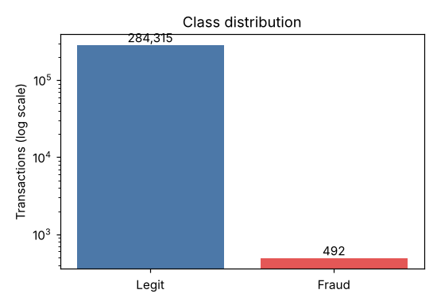
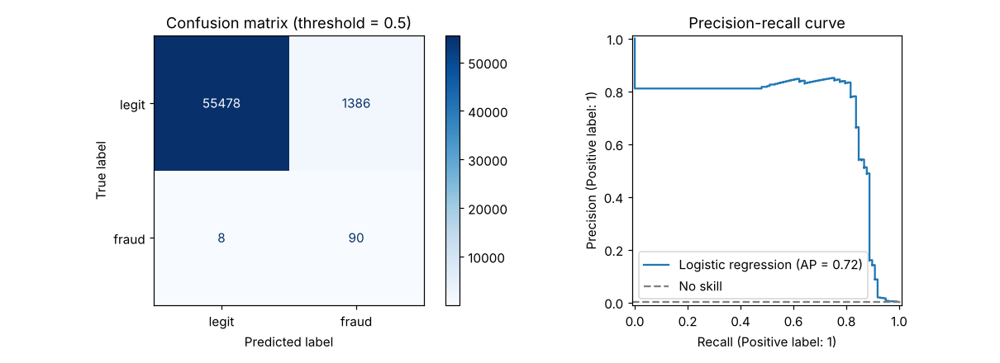

# Credit Card Fraud Detection (in progress)

Detecting fraudulent card transactions in a highly imbalanced dataset (~0.17% fraud).
The main goal is to learn how to handle imbalanced data properly: why accuracy is misleading,
how to avoid data leakage when resampling, and how to evaluate with precision, recall, F1 and PR-AUC.

> **Status:** work in progress. EDA and a baseline model are done; tree-based models, resampling and threshold tuning are next.
> Parts of the code were written with AI assistance (Claude); I review and run everything myself.

## Data
[ULB Credit Card Fraud Detection](https://www.kaggle.com/datasets/mlg-ulb/creditcardfraud) (Kaggle):
284,807 transactions, 492 frauds (0.173%). Features `V1`–`V28` are anonymised PCA components, plus `Time`, `Amount` and the target `Class`.

**The dataset is not included in this repository** (~150 MB). Download `creditcard.csv` from Kaggle and place it in `data/`.

## Project structure
```
├── data/                  # creditcard.csv goes here (git-ignored)
├── images/                # plots used in this README
├── notebooks/
│   └── 01_eda_and_baseline.ipynb
├── requirements.txt
└── README.md
```

## How to run
```bash
pip install -r requirements.txt
jupyter notebook notebooks/01_eda_and_baseline.ipynb
```

## Approach
- [x] Exploratory analysis
- [x] Stratified train/test split (done before any preprocessing)
- [x] Baseline: logistic regression with `class_weight="balanced"`
- [ ] Tree-based models (random forest / gradient boosting)
- [ ] Resampling (SMOTE / undersampling), applied to training folds only
- [ ] Cross-validation and model comparison
- [ ] Threshold tuning and final evaluation

## Results so far


A model that always predicts "legit" reaches 99.83% accuracy and catches 0% of frauds, so accuracy is not used to judge models here.

Baseline (logistic regression, class weights, 20% stratified hold-out set with 98 frauds, threshold 0.5):

| Metric | Value |
|---|---|
| Recall (fraud) | 0.918 (90 of 98 caught) |
| Precision (fraud) | 0.061 (1,386 false alarms) |
| F1 (fraud) | 0.114 |
| ROC-AUC | 0.972 |
| PR-AUC | 0.719 (no-skill: 0.002) |



The baseline catches most frauds but flags far too many legitimate transactions. ROC-AUC looks excellent
but is optimistic under this much imbalance, so PR-AUC is the metric to improve in the next stages.

## Limitations (so far)
- Results come from a single split with only 98 frauds in the test set, so they are noisy. Cross-validation is planned.
- The dataset contains 1,081 duplicated rows, which are kept for now; duplicates can end up on both sides of the split.
- Features are anonymised PCA components, so there is limited room for feature engineering or interpretation.

## Next steps
See the unchecked items in [Approach](#approach).
